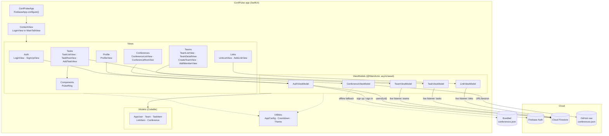
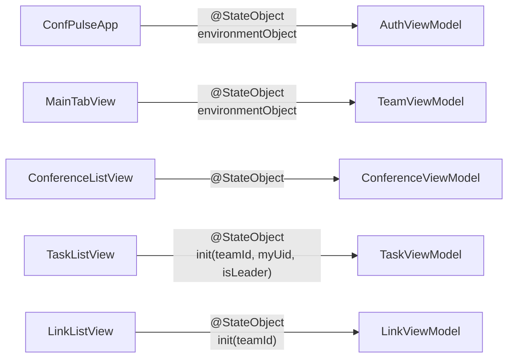
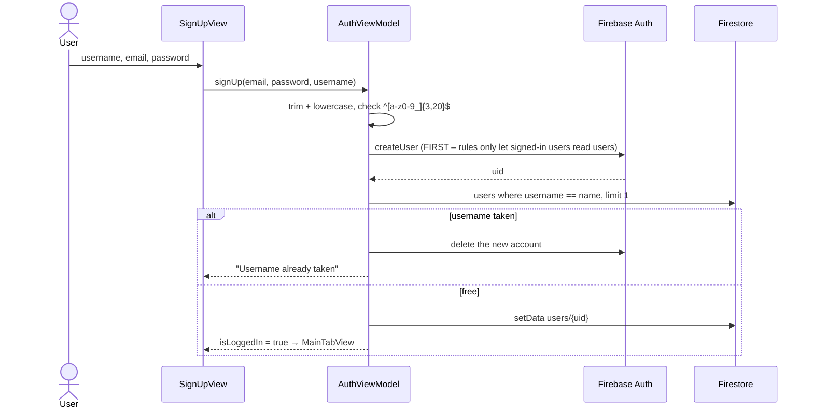
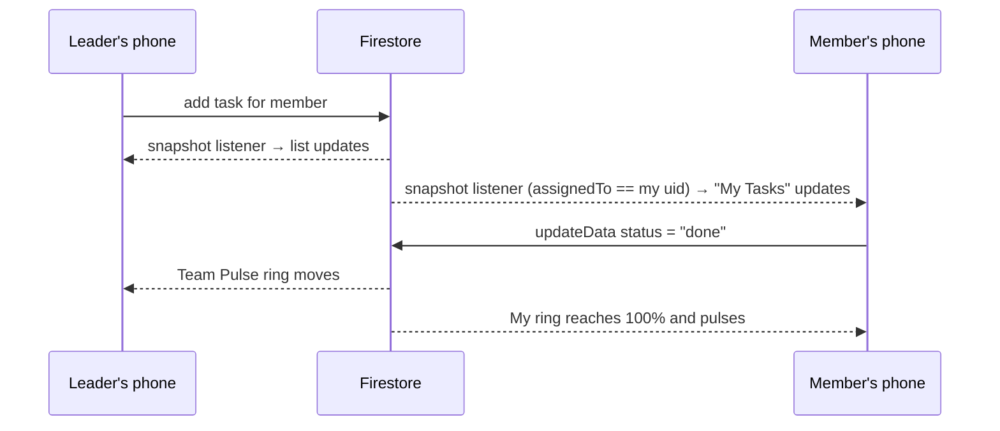
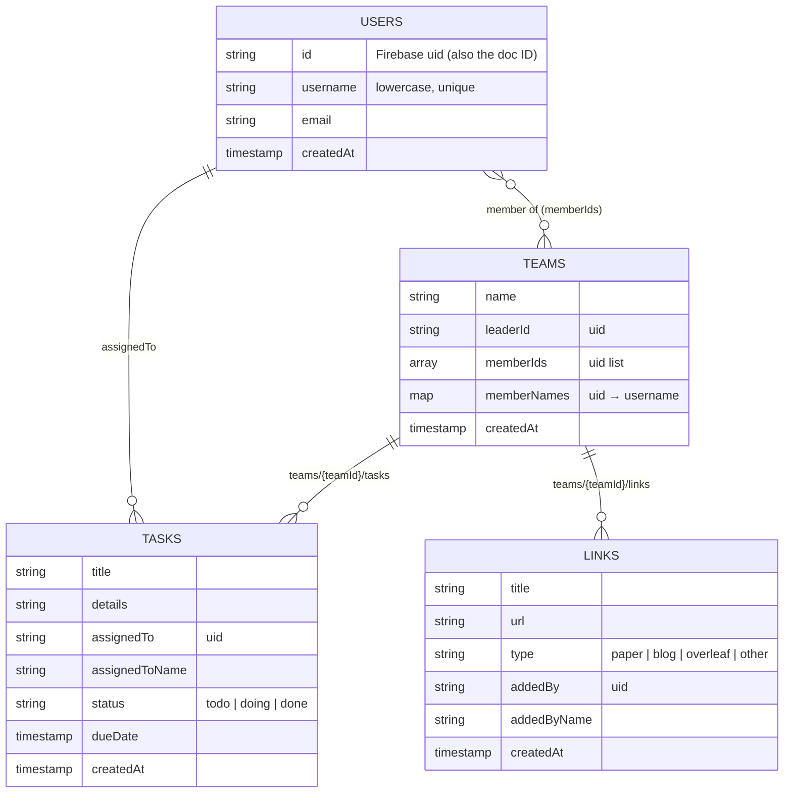

# ConfPulse – Research Team & Conference Tracker

> **Never miss a deadline as a team.**

ConfPulse is an iOS app for university research labs. It shows live countdowns to AI / ML / CV / NLP / Robotics conference deadlines and gives each lab team a shared space for **tasks** and **links** (papers, blogs, Overleaf projects), all synced in real time with Firebase.

Built with **SwiftUI + MVVM**, **async/await** and **Firebase** (Auth + Firestore). It has no other third-party libraries.

---

## Contents
1. [Features](#features)
2. [Tech stack](#tech-stack)
3. [Architecture](#architecture)
4. [Project structure](#project-structure)
5. [Firestore data model](#firestore-data-model)
6. [Security rules](#security-rules)
7. [Getting started](#getting-started)
8. [Conference feed](#conference-feed)
9. [Testing checklist](#testing-checklist)
10. [Design decisions](#design-decisions)

---

## Features

| Feature | What it does |
|---|---|
| **Accounts** | Sign up with email, password and a unique lowercase username. Sign in, stay signed in across restarts, log out. Shows friendly messages for wrong password, email in use, weak password and invalid email. |
| **Conferences** | Online JSON feed with an offline fallback. Each card shows a live countdown (`12d 04h 33m 09s`) and a coloured urgency bar (red < 7 days, orange < 30 days, green otherwise, grey = Closed). Search by name, filter by area, toggle "Hide closed", pull to refresh, open the website. |
| **Teams** | Create a team (you become the leader 👑). The team list updates live. Each team has a segmented view: **Tasks · Links · Members**. |
| **Members** | The leader searches users by username and adds them, with clear messages for "No user found", "That's you" and "Already in this team". The leader swipes to remove a member. Members can leave. |
| **Tasks** | The leader assigns tasks to members with a due date and sees them grouped by member. Members see only **My Tasks**. Tap the status chip to cycle *To Do → Doing → Done*, or swipe **Start** / **Done**. Overdue dates turn red. A **Team Pulse** ring shows the percentage done and pulses at 100%. |
| **Links** | Any member shares a paper, blog, Overleaf or other link. `https://` is added automatically and invalid URLs are rejected. Tap a link to open it. The person who added it, or the leader, can delete it. |

---

## Tech stack

| | |
|---|---|
| Language / UI | Swift 5.9, SwiftUI |
| Minimum iOS | 17.0 |
| Xcode | 15.2 or later |
| Architecture | MVVM, one `@MainActor` ViewModel per feature, async/await |
| Backend | Firebase Authentication (Email/Password), Cloud Firestore |
| Packages | `firebase-ios-sdk` via Swift Package Manager: **FirebaseAuth** and **FirebaseFirestore** only |
| Conference data | JSON file hosted on GitHub (raw URL), with a copy bundled in the app |

---

## Architecture

### Overview



### How the layers talk

- **Views** only draw the screen and forward user actions. They hold no Firebase code.
- **ViewModels** are `ObservableObject`s marked `@MainActor`. They talk to Firebase or the network with `async/await` and publish state (`@Published`) that the views redraw from.
- **Models** are plain `Codable` structs. Firestore turns documents into them with `data(as:)`.
- **Utilities** hold shared constants (`AppConfig`), pure helper functions (`Countdown`) and styling (`Theme`, `.cardStyle()`).

### Who owns which ViewModel



- **AuthViewModel** lives for the whole app, so every screen knows who is signed in.
- **TeamViewModel** lives in `MainTabView`. It starts its Firestore listener when the profile loads and stops on log out. The team screens stay live while you navigate.
- **TaskViewModel** and **LinkViewModel** are created per team and listen only while their segment is on screen.

### Sign-up flow



### Real-time sync



---

## Project structure

```
ConfPulse/
├── ConfPulseApp.swift              App entry: FirebaseApp.configure(), shares AuthViewModel
├── ContentView.swift               Root: LoginView or MainTabView
├── GoogleService-Info.plist        Firebase config (not committed to public repos)
├── Models/
│   ├── AppUser.swift               users/{uid}
│   ├── Team.swift                  teams/{teamId}
│   ├── TaskItem.swift              tasks + TaskStatus (todo/doing/done, title, color, cycled)
│   ├── LinkItem.swift              links + LinkType (paper/blog/overleaf/other, SF Symbol)
│   └── Conference.swift            one entry of conferences.json
├── ViewModels/
│   ├── AuthViewModel.swift         sign up / in / out, profile, friendly errors
│   ├── ConferenceViewModel.swift   download feed, offline fallback, search & filters
│   ├── TeamViewModel.swift         live teams, create, search/add/remove members
│   ├── TaskViewModel.swift         live tasks (leader: all, member: own), status, progress
│   └── LinkViewModel.swift         live links, add with URL check, delete
├── Views/
│   ├── MainTabView.swift           Conferences · Teams · Profile tabs
│   ├── Auth/                       LoginView, SignUpView
│   ├── Conferences/                ConferenceListView, ConferenceRowView
│   ├── Teams/                      TeamListView, CreateTeamView, TeamDetailView, AddMemberView
│   ├── Tasks/                      TaskListView, TaskRowView, AddTaskView
│   ├── Links/                      LinkListView, AddLinkView
│   ├── Profile/                    ProfileView
│   └── Components/                 PulseRing (Team Pulse progress ring)
├── Utilities/
│   ├── AppConfig.swift             collection names, feed URL, urgency limits
│   ├── Countdown.swift             text(until:now:) and color(until:now:)
│   └── Theme.swift                 coral "pulse" accent and .cardStyle()
├── Resources/
│   └── conferences.json            offline copy of the conference feed
├── Assets.xcassets
└── Preview Content
```

Each file holds one main type with the same name, and every function has a one-line comment above it.

---

## Firestore data model



| Path | Fields |
|---|---|
| `users/{uid}` | `id`, `username`, `email`, `createdAt` |
| `teams/{teamId}` | `name`, `leaderId`, `memberIds [uid]`, `memberNames {uid: username}`, `createdAt` |
| `teams/{teamId}/tasks/{taskId}` | `title`, `details`, `assignedTo`, `assignedToName`, `status`, `dueDate`, `createdAt` |
| `teams/{teamId}/links/{linkId}` | `title`, `url`, `type`, `addedBy`, `addedByName`, `createdAt` |

**No composite indexes needed.** Every query uses at most one `whereField`, and sorting happens in Swift:

| Query | Used for |
|---|---|
| `users` where `username == x` (limit 1) | unique username check, member search |
| `teams` where `memberIds` array-contains `uid` | my teams |
| `teams/{id}/tasks` (all) | leader's task list |
| `teams/{id}/tasks` where `assignedTo == uid` | member's "My Tasks" |
| `teams/{id}/links` (all) | team links |

---

## Security rules

Paste these into **Firebase console → Firestore → Rules → Publish**.

```
rules_version = '2';
service cloud.firestore {
  match /databases/{database}/documents {

    function signedIn() {
      return request.auth != null;
    }

    function isMember(teamId) {
      return signedIn() &&
        request.auth.uid in get(/databases/$(database)/documents/teams/$(teamId)).data.memberIds;
    }

    match /users/{uid} {
      allow read: if signedIn();
      allow create, update: if signedIn() && request.auth.uid == uid;
    }

    match /teams/{teamId} {
      allow read: if signedIn() && request.auth.uid in resource.data.memberIds;

      allow create: if signedIn()
        && request.resource.data.leaderId == request.auth.uid
        && request.resource.data.memberIds == [request.auth.uid];

      allow update: if signedIn() && (
        request.auth.uid == resource.data.leaderId
        || (request.auth.uid in resource.data.memberIds
            && request.resource.data.diff(resource.data).affectedKeys().hasOnly(['memberIds', 'memberNames'])
            && request.resource.data.memberIds == resource.data.memberIds.removeAll([request.auth.uid]))
      );

      match /tasks/{taskId} {
        allow read, write: if isMember(teamId);
      }
      match /links/{linkId} {
        allow read, write: if isMember(teamId);
      }
    }
  }
}
```

| Rule | Why |
|---|---|
| Any signed-in user can read `users` | Needed for the unique-username check and member search. |
| You can only write your own `users/{uid}` | Nobody can change someone else's profile. |
| Only members can read a team | Teams are private to their members. |
| Only the leader can update a team | Only the leader adds or removes members and renames the team. The one exception: a member may remove **only themselves** ("Leave team"). |
| Members can read and write tasks and links | Everyone in the team works on them. Who may delete is enforced in the UI: tasks by the leader, links by the person who added them or the leader. |

---

## Getting started

### Requirements
- A Mac with **Xcode 15.2+**
- A Google account for Firebase

### 1. Firebase
1. Go to [console.firebase.google.com](https://console.firebase.google.com), **Create a project**. Analytics is not needed.
2. Click **Add app ▸ iOS** and use the bundle ID `com.confpulselab.ConfPulse`.
3. Download **GoogleService-Info.plist**.
4. Go to **Authentication ▸ Sign-in method ▸ Email/Password ▸ Enable**.
5. Go to **Firestore Database ▸ Create database**. Use the database ID `(default)` and start in test mode, then publish the [security rules](#security-rules).

### 2. Xcode
1. Click **File ▸ New ▸ Project ▸ iOS App** and fill in:
   - Product Name `ConfPulse`
   - Organization Identifier `com.confpulselab`
   - Interface SwiftUI
2. Set **Minimum Deployments** to **iOS 17.0**.
3. Click **File ▸ Add Package Dependencies…**, enter `https://github.com/firebase/firebase-ios-sdk`, and add **FirebaseAuth** and **FirebaseFirestore** only.
4. Delete Xcode's template `ContentView.swift`, `ConfPulseApp.swift`, `Assets.xcassets` and `Preview Content`.
5. Drag the folders and files of this repo into the yellow **ConfPulse** group. Tick **Copy items if needed** and the **ConfPulse** target.
   - Leave `README.md` out of the target.
6. Add `GoogleService-Info.plist` to the same group, with the target ticked.
7. Check that **Build Phases ▸ Copy Bundle Resources** contains `conferences.json`.
8. Press **⌘R**.

---

## Conference feed

The conference list is downloaded from a public GitHub file, so it can be updated without shipping a new app version.

1. Create a **public** repo named `confpulse-data` and upload `Resources/conferences.json`.
2. Open the file, click **Raw**, and copy the URL.
3. Put the URL in `Utilities/AppConfig.swift` → `conferenceFeedURL`.

Feed format:

```json
[
  {
    "name": "CVPR",
    "fullName": "IEEE/CVF Conference on Computer Vision and Pattern Recognition",
    "area": "CV",
    "deadline": "2026-11-21T23:59:59-12:00",
    "location": "TBA",
    "website": "https://cvpr.thecvf.com"
  }
]
```

- **`area`:** one of `ML`, `CV`, `NLP`, `Robotics`, `Systems`.
- **`deadline`:** ISO 8601 with a timezone. AoE (Anywhere on Earth) deadlines use `-12:00`.
- **Offline fallback:** if the download fails, the app loads the bundled copy and shows *"Offline – showing saved list"*.

> ⚠️ The dates in `conferences.json` are **samples**. Check them on each conference's official website.

---

## Testing checklist

Use two accounts: **alice** (leader) and **bob** (member). Two simulators make the live updates easy to see.

**Auth**
- [ ] Sign up as alice → `users/{uid}` appears with a lowercase username
- [ ] Reusing the username `alice` → "Username already taken" (no extra Auth user created)
- [ ] Wrong password / weak password / invalid email → friendly messages
- [ ] Restart the app → still signed in; **Log out** → login screen

**Conferences**
- [ ] Countdown ticks every second; bar colours red / orange / green / grey "Closed"
- [ ] Area picker, search, **Hide closed**, **Website**, pull to refresh
- [ ] Wi-Fi off → "Offline – showing saved list"

**Teams & members**
- [ ] alice creates a team → 👑 and "1 member"; bob sees "No teams yet"
- [ ] Search `nobody` / `alice` / `bob` → "No user found" / "That's you" / result card → **Add**
- [ ] Team appears on bob's phone live; only alice sees **Add member**
- [ ] alice swipes to remove bob; her own row has no swipe; bob can **Leave team**

**Tasks**
- [ ] alice's tasks are grouped by member; bob sees only "My Tasks" with no **+** or delete
- [ ] Chip tap cycles To Do → Doing → Done; **Start** / **Done** swipes
- [ ] Overdue (not done) dates are red; the Team Pulse ring updates live and pulses at 100%

**Links**
- [ ] `arxiv.org/abs/1706.03762` → saved with `https://`, shows 📄 and `arxiv.org`
- [ ] `not a url` is rejected; tapping a link opens Safari
- [ ] bob can delete only his own links; alice can delete any link

**Security rules**
- [ ] Everything above still works after publishing the rules
- [ ] Rules Playground: unauthenticated read of `teams/{id}` → denied; bob renaming the team → denied

---

## Design decisions

- **`TaskItem`, not `Task`.** This avoids a clash with Swift concurrency's `Task`.
- **The Auth account is created before the username check.** The security rules only allow signed-in users to read `users`. If the name turns out to be taken, the new account is deleted again.
- **Snapshot listeners instead of manual refreshes.** Teams, tasks and links update on every phone within a second, with no reload code.
- **One `whereField` per query, sorted in Swift.** No composite indexes to create or maintain.
- **`memberNames` map on the team.** Showing member names needs no extra `users` reads. Adding uses the key `memberNames.<uid>`, and removing uses `FieldValue.delete()`.
- **Pure `Countdown` functions.** `text(until:now:)` and `color(until:now:)` take the current time as a parameter, so they are easy to test and to change.
- **`GoogleService-Info.plist`.** Keep it out of public repositories. Data is protected by the security rules, not by hiding the file.

---

*University lab project. SwiftUI · MVVM · Firebase.*
